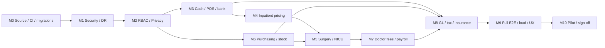

# خارطة التنفيذ الكاملة لنظام حسابات مستشفى رمسيس

**Baseline:** V8.1E-G2P (31 October 2026) | **Source ZIP SHA256:** `f83baf274fe5df1a3cd68190eb87a5d254539af449dfc94ac37ac0035d0454a7` | **Release status: NO-GO**.

الترتيب مبني على الاعتماد المتبادل لا على الشكل: تثبيت البيانات والأمان ثم إكمال دورة العلاج والتكلفة ثم الرقابة والتشغيل.

> **لا نسبة إنجاز صورية: كل مرحلة لا تعتبر منتهية إلا بعد نجاح اختبار مسارها الحقيقي وموافقة المسؤول عنها.**

> **لا يعني نجاح اختبار محلي اعتماد التشغيل الحقيقي. لا تستخدم بيانات مرضى أو أموالًا فعلية قبل اكتمال بوابات الاعتماد.**

## Starting facts and release rules
- Inspected G2P: 18 Python modules, 165 FastAPI route handlers, 80 tables, 101 triggers, 76 Python test scripts.
- Fresh results: **72 passed, 3 skipped (missing historical source), 1 blocked/failing (genuine V8.0 archive missing)**. These counts are scripts, not statement or branch coverage.
- Existing foundation: cash shifts, vault handovers, ledger, patient billing and advances, POS, bank reconciliation, opening balances, patient-financial close and encrypted backup tools. They still require operational acceptance.
- **Source is a ZIP, not a versioned Git repo; deployment and real-hospital acceptance not observed.** This is a plan and audit, not a claim of deployment or code changes.
- **Business scope:** one Ramses Hospital initially; clinical admission authorization is not equivalent to financial case close.
- Schedule: use relative effort S/M/L/XL, not arbitrary release dates. Define capacity, staff roster, accounting policy and volume before setting calendar.

## Dependency map

M6 may start alongside M3/M4 when M0/M2 contracts stabilize. M5 needs real stock issue/return functionality from M6, and M8 closes only when every new subledger can be independently reconciled.

## بوابات الإصدار الإلزامية
| Gate | Required independently verifiable evidence | Decision owner |
|---|---|---|
| G0 | Immutable G2P baseline, Git/CI, real migration fixture; no unauthorized source changes | Engineering lead |
| G1 | Data minimization, deny-by-default authorization matrix for all sensitive routes, safe encrypted off-device backups, tested restoration | IT/security and hospital owner |
| G2 | Cash/shift/bank/POS plus inpatient and clinical-resource charge reconciliation from source documents | Chief accountant + operations |
| G3 | Stock/AP/physician/payroll/insurance subledgers independently tie to GL and month close rejects mismatches | Chief accountant |
| G4 | E2E browser/API/DB, security, load, accessibility and DR on representative installed devices | QA and IT |
| G5 | Signed finance, clinical, IT and management UAT; a tested rollback and staged pilot | Hospital management |

## المرحلة M0-M10

### M0 — تثبيت المصدر والهجرات والاختبارات الآلية

**التبعيات:** none  |  **المسؤول الرئيسي:** Engineering lead + accountant  |  **Relative effort:** L  |  **Current state:** not production-verified.

**الأعمال التنفيذية**

| Ticket | Implementation deliverable | Executable acceptance / evidence |
|---|---|---|
| `M0-GIT-01` | Create a private, access-controlled Git repo; tag immutable G2P SHA, signed artifact manifest | Rebuild a clean ZIP matching baseline and produce inspectable change diff. |
| `M0-CI-02` | Add CI gates: compile, JS check, lint, tests, secrets scan, dependency scanning | PR cannot merge when test or audit gate fails. |
| `M0-DB-03` | Introduce numbered, transactional schema migrations with schema_version ledger and backup preflight | Apply migrations twice to copies of G2O and G2P without data loss; reject older schema safely. |
| `M0-LEG-04` | Recover genuine V8.0 and other archived fixture ZIPs and rerun historical upgrade scripts | Zero blocked historical migration tests on genuine fixture data. |
| `M0-ARCH-05` | Create interface map for auth, ledger posting, treasury and billing; move code incrementally | No behavioral changes after each small seam extraction; all baseline tests green. |

**تذاكر التنفيذ (findings directly linked)**

| Finding | Priority | Problem and proposed action | Acceptance |
|---|---|---|---|
| `F-007` | **P0** | اختبار V8.0 التاريخي لم يكتمل استلام الأرشيف الحقيقي والتحقق من SHA، تشغيل ترقية متدرجة على نسخة معزولة، مقارنة عينات الأرصدة والعلاقات | اختبار الترحيل من الأرشيف الحقيقي PASS، ومعه تقرير قبل/بعد وrollback |
| `F-017` | **P1** | لا يوجد مستودع Git/CI ضمن الحزمة المسلّمة G2P تحويل الحزمة لمستودع خاص، Tag للإصدار الحالي، CI للاختبارات والفحص الأمني والمراجعة | كل PR يمر بالاختبارات، مراجعة تغيير DB، Manifest، إصدار موثوق وقابل للتراجع |
| `F-018` | **P1** | app.py كبير وذو مسؤوليات واسعة وتوجد تبعيات متبادلة بين الوحدات تحسين مواضع الفصل: auth, permission policy, posting, month-close, routes تدريجيًا بدون إعادة كتابة | انخفاض التداخل مع اختبارات حدود واضحة وتجارب ترقية دون تغيير قواعد المال |
| `F-023` | **P1** | ترقيات SQL تتم برمجيًا داخل bootstrap.py بدون سجل migrations مرقّم مستقل اعتماد نسخ قاعدة مُرقّمة وفحص قبل/بعد وترقية من V7/V8/G2P، فصل preflight عن التعديل | إعادة الترقية idempotent وتراجع متحكم به على جميع نسخ المصدر التاريخية |

**اختبارات القبول / release evidence:** Reproducible build with diff, migration rollback rehearsal and 76/76 executable tests.

### M1 — الأمان والخصوصية والنسخ الاحتياطي والتعافي

**التبعيات:** M0  |  **المسؤول الرئيسي:** Security + IT operations + hospital owner  |  **Relative effort:** L  |  **Current state:** not production-verified.

**الأعمال التنفيذية**

| Ticket | Implementation deliverable | Executable acceptance / evidence |
|---|---|---|
| `M1-SEC-01` | Fix login abuse controls against attacker-driven username lockout, strengthen privileged authentication | Simulate IP/username distributed attempts without locking out legitimate user. |
| `M1-BAK-02` | Retire default plaintext backup path; encrypted automatic off-device retention and immutable key custody | Independent operator restores encrypted backup on second isolated host, verifies ledger checksums. |
| `M1-AUD-03` | Make financial audit log tamper evident with export to independent restricted storage | A malicious database edit results in detected mismatch against externally anchored record. |
| `M1-PII-04` | Data classification, retention schedule, erasure/legal hold, external Google Sheets permission review | Owner signs data governance policy and test user cannot export salary or patient data. |
| `M1-FILE-05` | Attachment content-type verification, size ceilings, access logs, anti-malware scanning policy | Fake MIME, oversized and unauthorized requests blocked in integration tests. |

**تذاكر التنفيذ (findings directly linked)**

| Finding | Priority | Problem and proposed action | Acceptance |
|---|---|---|---|
| `F-006` | **P0** | النسخ خارج الجهاز واستعادة كاملة على جهاز آخر غير مثبتتين تشفير + نسخة خارج الجهاز مع مراقبة وفصل مفاتيح + تجارب استعادة موثقة + RPO/RTO معتمد | استعادة مستقلة تتحقق من التوافق والتواريخ والقيود وملفات المرفقات، مع اختبار انقطاع الطاقة |
| `F-012` | **P1** | إمكان قفل اسم مستخدم بهجمات كلمات سر بسبب حد محاولات مرتبط بالاسم فقط معدل محاولات متعدد المفاتيح، backoff، حماية حسب المصدر والجلسة والتنبيه دون قفل اسم مستهدف بالكامل | اختبار محاولات موزعة ومكررة؛ لا يتم تعطيل مالك النظام بمجرد 5 محاولات من عميل آخر |
| `F-014` | **P1** | مرآة Google Sheets تنقل أسماء الموظفين وكشوف المرتبات والـAudit إلى خدمة خارجية عند تفعيلها مراجعة موافقة الجهة، IAM وحصر المشاركة، تقليل الحقول، سياسة احتفاظ وإغلاق المزامنة افتراضيًا | اختبار مشاركة ورقة تجريبية ومراجعة صلاحيات المالك + عدم وجود PII غير ضرورية |
| `F-015` | **P1** | ما زالت أداة backup.py وbackup_local.sh تنتجان ملف SQLite صريحًا على القرص استبدال المسار الافتراضي بالنسخ المشفر، قصر النص الصريح على ترحيل معزول بأذونات وتوثيق | أمر النسخ الافتراضي لا يترك نسخة عارية، ويمكن اختبار نسخة مشفرة واستعادتها على جهاز ثان |
| `F-016` | **P1** | audit_log ليس له Trigger مانع لتعديل/حذف السجل مباشرة طبقة append-only/سلسلة تجزئة وتخزين سجل مستقل غير قابل لتعديل موظفي النظام | تغيير سجل تدقيق اختباري يُكشف في فحص السلامة والتحقق من نسخة خارجية |
| `F-020` | **P1** | CSRF وCSP موجودان لكن MFA وIP-aware rate limit وفصل حساب الطوارئ غير مثبت مراجعة المصادقة والجلسات وإضافة MFA/إعادة تحقق للإجراءات الحساسة وخطة break-glass | تجربة جلسة مسروقة/إلغاء جلسة/تغيير كلمة سر وMFA لجميع مالكي النظام |
| `F-030` | **P1** | المرفقات والأدلة تحتاج سياسة احتفاظ وعزل وفحص محتوى وتسجيل وصول مراجعة MIME/size والمصادقة وربط التخزين والتشفير وسياسة retention وتسجيل التحميل | ملف غير مطابق/MIME مزيف يرفض، وسحب تفويض يمنع تحميل صورة ظرف |
| `F-032` | **P1** | لا توجد سياسة نهائية للاحتفاظ والخصوصية والأرشفة وإيقاف المستخدمين ومفاتيح النسخ مصفوفة تصنيف البيانات، الاحتفاظ، الوصول، الإزالة القانونية، الموافقات والعقود والنسخ | محضر سياسة معتمد وأدلة مراجعة حسابات وتخزين ومتابعة شهريًا |

**اختبارات القبول / release evidence:** Threat model reviewed; backup recovery RPO/RTO agreed and demonstrated; no open sensitive-data P0.

### M2 — صلاحيات الموظفين والواجهات حسب الدور

**التبعيات:** M0, M1  |  **المسؤول الرئيسي:** Product owner + finance controller + security  |  **Relative effort:** XL  |  **Current state:** not production-verified.

**الأعمال التنفيذية**

| Ticket | Implementation deliverable | Executable acceptance / evidence |
|---|---|---|
| `M2-RBAC-01` | Inventory each of 165 API endpoints and each data read/write with action and scope | All routes have explicit role/scope decision and forbidden-role test. |
| `M2-RBAC-02` | Introduce minimal role templates: cashier, internal vault, reviewer, finance admin, clinical charge, warehouse, doctor, read only | No menu leakage and no backend IDOR by changing case, receipt, employee, bank or vault IDs. |
| `M2-RBAC-03` | Dedicated time-limited emergency delegations with two-person override policy | Maker never approves own transaction; emergency route expires and is reviewable. |
| `M2-UX-01` | Task-first landing pages and deep links with hidden off-scope modules | Role-based navigation survives refresh and 320px mobile navigation test. |

**تذاكر التنفيذ (findings directly linked)**

| Finding | Priority | Problem and proposed action | Acceptance |
|---|---|---|---|
| `F-005` | **P0** | الصلاحيات ما زالت أدوارًا عامة مع استثناءات للنقطة/البنك لا مصفوفة شاملة مصفوفة أدوار/عمليات/نطاق قسم/نقطة/خزنة/موظف؛ فحص IDOR لكل 165 API؛ إدارة أدوار معطلة افتراضيًا | اختبار owner/reviewer/clerk/viewer/بدون تفويض/بعد سحب تفويض لكل endpoint؛ جميع الحالات تمنع حسب النطاق |
| `F-013` | **P1** | واجهة lookups ترسل جميع الموظفين النشطين لأي مستخدم مسجل فصل القوائم إلى lookups حسب السياق والوظيفة، تقليل الحقول وحصر payroll للموظف المخوّل | كاشير/مشاهد غير مخول لا يحصل على قائمة موظفين كاملة؛ صاحب الحق يرى فقط المطلوب |
| `F-024` | **P2** | القائمة تضم عددًا كبيرًا من مداخل التشغيل والتقارير ولا تستخدم روابط عميقة قوائم حسب الدور، مسارات/هاش قابلة للمشاركة، البحث والتنقل السريع | للمراجع/الكاشير صفحات أقل بحسب المهمة، رابط مباشر يعود للحالة ذاتها بعد refresh |
| `F-028` | **P1** | المالك قد يجمع طلب واعتماد عمليات في حالات قليلة عند نقص الموظفين؛ يلزم سياسة استثناء مستقلة وكيل مراجعة مستقل مؤقت وتفويض مقيد بالمدة مع تنبيه للمالك، دون تعطيل قيود المحاسبة | تجربة يوم مع مراجع واحد ثم غيابه؛ منع اعتماد الذات وحفظ سلسلة مسؤوليات |

**اختبارات القبول / release evidence:** Endpoint permission matrix, signed by hospital owner, 100% negative permission tests for high-risk routes.

### M3 — الكاشير والخزن والبنوك وتسويات الفترات

**التبعيات:** M0, M2  |  **المسؤول الرئيسي:** Head cashier + finance reviewer  |  **Relative effort:** L  |  **Current state:** not production-verified.

**الأعمال التنفيذية**

| Ticket | Implementation deliverable | Executable acceptance / evidence |
|---|---|---|
| `M3-CASH-01` | Formalize actual external shifts to central internal vault handover, envelope custody, suspense pools and late evidence | Three shifts reconcile to single vault journal with no double cash posting. |
| `M3-BANK-01` | Chargeback, refund and unsettled POS clearing across month boundaries | Chargeback after prior month closes through approved current-period adjustments, no historical journal overwrite. |
| `M3-CASE-01` | Add post-financial-close correction with supplemental credit/debit, no reopening without audit approval | Correct a closed case without changing original posting and with offsetting GL entry. |
| `M3-CAL-01` | Central Cairo business date and immutable transaction date semantics | Month-end and overnight shift boundary pass with off-timezone workstation. |
| `M3-CLOSE-01` | Daily shift/vault/cashier close preflight with missing closure alerts | Every shift either approved or explicit exception, and cash journal totals match. |

**تذاكر التنفيذ (findings directly linked)**

| Finding | Priority | Problem and proposed action | Acceptance |
|---|---|---|---|
| `F-009` | **P1** | لا يوجد تصحيح رسمي بعد إغلاق الملف المالي إجراء إضافة/إشعار دائن لاحق بموافقة مستقلة دون تعديل السجل المعتمد، وربط المستند بالحالة المغلقة | تصحيح بعد الإقفال يولد سند تعديل مستقل، أثرًا تدقيقيًا ويحافظ على شهر مغلق |
| `F-010` | **P1** | حالات الاسترداد والـchargeback والتسوية العابرة للشهور غير مكتملة مسار chargeback/refund، تسوية نهاية الشهر المعلقة، رسوم التحصيل ومراجع البنك | تسوية قبل/بعد شهر، رد 1 من 3 إيصالات، رسوم وخصم دون تكرار AR أو الخزنة |
| `F-027` | **P2** | بعض قيم التاريخ الافتراضية من تاريخ جهاز الموظف بدلاً من يوم القاهرة تاريخ تشغيل معتمد من الخادم مع إمكانية التعديل المراقب وأسباب إدخال متأخر | اختبارات Cairo DST و00:00/08:00 و31/1 وتغيير ساعة الجهاز |

**اختبارات القبول / release evidence:** Synthetic multi-shift 30-day journal reconciles cash, vault, bank and POS with zero unexplained variance.

### M4 — الإقامة الداخلية وإشغال الأسرة والتسعير

**التبعيات:** M0, M2, M3  |  **المسؤول الرئيسي:** Inpatient admission + nursing + revenue office  |  **Relative effort:** XL  |  **Current state:** not production-verified.

**الأعمال التنفيذية**

| Ticket | Implementation deliverable | Executable acceptance / evidence |
|---|---|---|
| `M4-IP-01` | Patient admission/transfer/bed occupancy intervals with non-overlap per bed | No bed double booked; midnight transfer and backdate concurrency handled. |
| `M4-IP-02` | Versioned tariffs and per-day/partial-day rules, including NICU bed classification | Charge exact sample stay once; historical tariff change does not rewrite prior bill. |
| `M4-IP-03` | Link service fulfillment/bed charges to invoice, deposits, patient balances and financial clearance | Cannot financially close a stay with unbilled occupied nights or unresolved advance. |
| `M4-IP-04` | Separate clinical discharge authorization from financial checkout | Finance approval cannot create a clinical discharge event. |

**تذاكر التنفيذ (findings directly linked)**

| Finding | Priority | Problem and proposed action | Acceptance |
|---|---|---|---|
| `F-001` | **P0** | غياب إدارة إشغال السرير وفترة الإقامة وتسعيرها جدول إقامة/سرير/نقل بسجلات مؤرخة، سياسة يوم/ساعة، أسعار تاريخية، توليد خدمات مؤكد قبل تصفية الملف | حجز سرير/نقل/خروج/نوبة منتصف الليل/تحويل أقسام، وعدم تكرار اليومية، قفل الملف عند خدمات غير مفوترة |

**اختبارات القبول / release evidence:** 20 realistic admission/transfer/discharge scenarios signed by reception, nursing, billing and finance.

### M5 — حسابات العمليات والحضانات وتكلفة الإجراء

**التبعيات:** M4, M6  |  **المسؤول الرئيسي:** Surgery/NICU head + clinical finance  |  **Relative effort:** XL  |  **Current state:** not production-verified.

**الأعمال التنفيذية**

| Ticket | Implementation deliverable | Executable acceptance / evidence |
|---|---|---|
| `M5-OR-01` | Versioned procedure bundles and operating room resource/time usage | Different tariffs and excluded items bill at correct rate without duplicates. |
| `M5-OR-02` | NICU service order and time-based equipment/medication charge models | Partial day, high-acuity and device changes remain auditable. |
| `M5-OR-03` | Patient-level consumable issuing/return tied to inventory and per-case costing | Every sterile consumable has issue/return document and stock movement. |
| `M5-OR-04` | Clinical signoff and finance dispute path for canceled or changed procedure | Canceled procedure reverses outstanding charges and stock movement with approval. |

**تذاكر التنفيذ (findings directly linked)**

| Finding | Priority | Problem and proposed action | Acceptance |
|---|---|---|---|
| `F-002` | **P0** | غياب باقات العمليات والحضانة وربط مستهلكاتها كارت تكلفة إجراء، مكونات باقة قابلة للإصدار، أوامر خدمة معتمدة، خصم مستهلكات من المخزون | سيناريو عملية/حضانة يثبت الخدمات والمستلزمات والمرتجعات مرة واحدة فقط |

**اختبارات القبول / release evidence:** Two worked surgery and NICU cases show revenue, direct cost, retained stock and doctor payable linkage.

### M6 — المشتريات والمخازن والموردون

**التبعيات:** M0, M2  |  **المسؤول الرئيسي:** Purchasing + warehouse + finance controller  |  **Relative effort:** XL  |  **Current state:** not production-verified.

**الأعمال التنفيذية**

| Ticket | Implementation deliverable | Executable acceptance / evidence |
|---|---|---|
| `M6-INV-01` | Item/lot/expiry master with minimum balances and restricted clinical item issue | Expiry/negative stock/duplicate SKU and unauthorized issues prevented. |
| `M6-PO-01` | Requisition, approved PO, receipt (GRN), supplier invoice and 3-way match | Partial receipt, price mismatch, returns and duplicate supplier invoice cases pass. |
| `M6-AP-01` | Supplier ledger, accrual, approved supplier credit, payment and GL reconciliations | AP balance equals approved unpaid invoices less credits/payments. |
| `M6-COST-01` | Costing policy (FIFO/weighted average), waste, physical count and cost centers | Controlled physical count and stock valuation yield reconciled GL balances. |

**تذاكر التنفيذ (findings directly linked)**

| Finding | Priority | Problem and proposed action | Acceptance |
|---|---|---|---|
| `F-003` | **P0** | عدم وجود دورة متكاملة للمشتريات والمخازن والموردين مستند طلب شراء→أمر→إذن استلام→فاتورة مورد→صرف/إرجاع→مطابقة GL | اختبار استلام جزئي، مرتجع، ثلاثي المستندات، استحقاق مورد، صرف حالة، حركة سلبية مرفوضة |

**اختبارات القبول / release evidence:** No negative inventory; inventory/AP subledgers and general ledger reconcile in a staged full month.

### M7 — أتعاب الأطباء والمرتبات وتكلفة العاملين

**التبعيات:** M4, M5, M6  |  **المسؤول الرئيسي:** Medical director + HR + payroll controller  |  **Relative effort:** L  |  **Current state:** not production-verified.

**الأعمال التنفيذية**

| Ticket | Implementation deliverable | Executable acceptance / evidence |
|---|---|---|
| `M7-DOC-01` | Physician fee contracts by physician, specialty, procedure and effective date | Completed procedure generates at most one accrued payable using historical agreement. |
| `M7-DOC-02` | Disputes, fee adjustments, approval and payment settlements | No self-approved changes; doctor ledger and GL control reconcile. |
| `M7-PAY-01` | Payroll source attendance, leave/extra rules, supervisor and finance signoff | No double salary payment and statutory/department cost lines reconcile. |
| `M7-PAY-02` | Department-level time/cost allocation with audited adjustments | Staff time is costed to the right department without altering settled payroll. |

**تذاكر التنفيذ (findings directly linked)**

| Finding | Priority | Problem and proposed action | Acceptance |
|---|---|---|---|
| `F-004` | **P0** | غياب احتساب واستحقاق وصرف أتعاب الأطباء عقود طبيب بنسب/مبالغ/أقسام وتاريخ سريان؛ استحقاق بعد الخدمة/التحصيل وفق السياسة؛ كشف مراجعة وتسوية | طبيب متعدد نسب، خصومات، إشعارات دائنة، رد مبلغ، استقطاع، منع صرف مكرر |
| `F-022` | **P1** | نظام مرتبات الموظفين لا يساوي نظام تكاليف الموارد البشرية الكامل تعريف مصدر حضور مرجعي وسياسات حسم/إضافي وامتثال وتكلفة لكل قسم | يُصادق صاحب الدور على ساعات وأجور، ويُمنع صرف راتب مرتين |

**اختبارات القبول / release evidence:** Three worked monthly doctor/payroll examples signed by HR and medical finance.

### M8 — الأستاذ العام والإقفال والتأمين والضرائب

**التبعيات:** M3, M5, M6, M7  |  **المسؤول الرئيسي:** Chief accountant + tax/insurance advisor  |  **Relative effort:** XL  |  **Current state:** not production-verified.

**الأعمال التنفيذية**

| Ticket | Implementation deliverable | Executable acceptance / evidence |
|---|---|---|
| `M8-GL-01` | Map all control accounts to independently calculated receivables/payables/stock/fees/banks | Any mismatch blocks month-close with source document evidence. |
| `M8-GL-02` | Accruals, prepayments, fixed assets, depreciation and year-end carry-forward | Trial balance remains balanced and certified year-end journal is traceable. |
| `M8-INS-01` | Insurance contract, eligibility, claims acceptance/rejection and recoverable payer balance | Patient vs insurer balances and rejected claims handled without double receivable. |
| `M8-TAX-01` | Confirm Egyptian e-invoice/e-receipt and statutory requirements with qualified advisor | Approved legal accounting matrix; no fictitious regulatory-compliance claim. |
| `M8-REPORT-01` | Financial statements, departmental margin, aging, and audit export tied to source docs | Report agrees to ledger and subledgers for sampled periods. |

**تذاكر التنفيذ (findings directly linked)**

| Finding | Priority | Problem and proposed action | Acceptance |
|---|---|---|---|
| `F-011` | **P1** | المطابقة الرقابية ليست شاملة لجميع الدفاتر المساعدة مُطابقات مستقلة لكل subledger وGL control accounts + حالات استثناء موثقة | إقفال شهر يرفض mismatch في مخزون ومورد وأطباء وبنك وPOS والمرضى ويصدر فحصًا قابلًا للتصدير |
| `F-021` | **P1** | الالتزام الضريبي/الفوترة الإلكترونية والعقود الطبية والتأمين غير مصمم نهائيًا قرار محاسبي/قانوني مصري؛ ضريبة وختم/إيصال، جهات تأمين، موافقات وأسعار متعاقد عليها | حالات خدمات مختلفة ضريبيًا وفواتير شركات وتأمين ومطالبات مرفوضة/مقبولة |
| `F-029` | **P1** | لا يوجد إقفال سنة متكامل وحسابات قياسية لكل أعمال المستشفى سنة مالية، إهلاك أصول، مصروفات مستحقة/مقدمة، مطابقة أستاذ، سياسة قيود الإقفال | قوائم محاسبية مصدّق عليها بعد نقل قيود المصروفات/الإهلاك وإقفال سنة |

**اختبارات القبول / release evidence:** Independent finance controller signs month and year-end reconciliation on synthetic full-hospital books.

### M9 — اختبارات التكامل والأداء وسهولة الاستخدام

**التبعيات:** M0, M1, M2, M3, M4, M5, M6, M7, M8  |  **المسؤول الرئيسي:** QA lead + accessibility reviewer + IT admin  |  **Relative effort:** L  |  **Current state:** not production-verified.

**الأعمال التنفيذية**

| Ticket | Implementation deliverable | Executable acceptance / evidence |
|---|---|---|
| `M9-E2E-01` | Full browser to API to DB journeys for 8 roles at 320/375/768/1440 | No unauthorized access, duplicated money, missing states or console error. |
| `M9-LOAD-01` | Concurrency/load test for expected cashier workstations, month close, WAL and backup | Measured P95 and error rates meet agreed operational thresholds; zero lost postings. |
| `M9-A11Y-01` | Screen reader, keyboard-only, 200% zoom, contrast and Arabic/English number formats | All critical financial workflows doable without mouse and no clipped controls. |
| `M9-DR-01` | Cold restore on separate hospital-like host, compare manifest and financial checksums | Verified recovery within agreed RTO/RPO with independent administrator. |
| `M9-PEN-01` | Independent risk-based penetration review and dependency scanning | No unresolved high/critical vulnerabilities prior to pilot. |

**تذاكر التنفيذ (findings directly linked)**

| Finding | Priority | Problem and proposed action | Acceptance |
|---|---|---|---|
| `F-019` | **P1** | SQLite WAL بخادم واحد يحتاج اختبار حمل وتزامن قبل تشغيل عدة كاشيرات Benchmark محاكاة عدد موظفين وسيناريوهات تزاحم، وخطة نقل إلى PostgreSQL إذا تجاوز الحدود | أرقام P95 وملفات Deadlocks/timeout وقيود مالية سليمة تحت الحمل المحدد |
| `F-025` | **P2** | عدة تسميات ومعلومات مساعدة أقل من 12px في CSS رفع الحد الأدنى للنص التشغيلي وتحسين تباين الحالات ومناطق اللمس | 320px و375px وتكبير 200% بلا فقد تحذير أو زر اعتماد؛ اختبارات قارئ شاشة |
| `F-026` | **P2** | لا يظهر رابط تجاوز القائمة إلى المحتوى الرئيسي في HTML إضافة رابط skip-to-content مرئي عند التركيز، وضبط focus بعد تغيير الصفحة | التنقل Tab/Shift+Tab وEscape في dialog مع إعلان الأخطاء لقارئ الشاشة |
| `F-031` | **P2** | فحص المتصفح المتصل مباشرة بالخادم غير ممكن في بيئة التدقيق الحالية اختبار Chromium على شبكة تجريبية حقيقية مع 4 أدوار و3 مقاسات، traces وتقرير Console | تسجيل 50 رحلة ناجحة مع لقطات وقيود DB قبل/بعد واختبار خطأ شبكة |

**اختبارات القبول / release evidence:** Signed acceptance matrix for security, performance, UX, backups and end-to-end workflows.

### M10 — التجربة الميدانية والقبول وقرار التشغيل

**التبعيات:** M9  |  **المسؤول الرئيسي:** Hospital GM + finance director + medical director + IT  |  **Relative effort:** M  |  **Current state:** not production-verified.

**الأعمال التنفيذية**

| Ticket | Implementation deliverable | Executable acceptance / evidence |
|---|---|---|
| `M10-PILOT-01` | Staged training on synthetic/de-identified records, then controlled shadow ledger | Staff reconcile every pilot shift to old process without risk to actual cash. |
| `M10-CUT-01` | Signed cutover checklist with starting balances, archive snapshot, go/no-go board | Rollback tested, cutover balances certified by chief accountant. |
| `M10-OPS-01` | Runbooks for outage, rejected settlement, late cashier closing, lost password and incident response | Shift supervisors demonstrate procedures in tabletop exercises. |
| `M10-SIGN-01` | Four independent approvals: finance, clinical, security/IT, hospital management | Go decision only after all signatures and no P0/P1 release-blocker remains. |

**تذاكر التنفيذ (findings directly linked)**

| Finding | Priority | Problem and proposed action | Acceptance |
|---|---|---|---|
| `F-008` | **P0** | لا توجد تجربة استخدام مالية حقيقية أو توقيع محاسب ومدير نظم UAT مع محاسب مستقل وكاشير خارجي/داخلي، شبكة أجهزة، تعافٍ، إقفال شهر كامل بمحاكاة | اعتماد مالي وأمني وإداري مكتوب، مع عدم وجود P0/P1 غير مقبول |

**اختبارات القبول / release evidence:** Live money authorized only after documented signoffs, staged deployment, recovery rehearsal and monitored pilot.

## Acceptance matrix for representative hospital scenarios

| Scenario | Input / roles | Forbidden outcome | Evidence required |
|---|---|---|---|
| External night / morning / evening shifts → central vault | 3 separate cashiers, internal custodian, reviewer | Duplicate cash or a missing envelope silently approved | Per-shift and vault voucher totals, evidence photos, reconciliation, independent signature |
| Late paper invoice after physical cash handover | Collector, main vault, billing clerk | Second collection when invoice entered | Suspense pool allocation and one GL cash movement |
| Patient takes 25% advance then moves bed | Admission, cashier, nursing, finance | Advance counted as service revenue before treatment | Subledger prepayment, true tariff timing, issued service, GL reconciliations |
| Operation cancellation after consumables issued | Doctor, OR nurse, storekeeper, reviewer | Unapproved stock loss or phantom procedure charge | Reversal/return documents, independent approval and clinical note |
| NICU child changes care level across midnight | Clinician, nursing, pricing, billing | Two charges for a single time interval | Nonoverlapping occupancy, rate history, invoice line genealogy |
| Supplier bill and physical inventory disagree | Purchasing, warehouse, AP reviewer | Pay invoice without accepted goods at wrong price | PO-GRN-Invoice three-way match, variance hold |
| Doctor entitled to percentage after case refund | Medical director, payables reviewer | Paying fee from reversed service or twice | Adjusted doctor subledger and source document lineage |
| POS chargeback occurs after month close | Bank user, separate reviewer | Rewrite closed-month patient receipt | Current-month adjustment, matched bank source, unchanged historical journal |
| Two reviewers close a case simultaneously | Maker, two checkers | Two close records or extra GL money | Transaction/DB uniqueness, one approval wins |
| Employee loses permission mid-session | Owner, cashier, reviewer | Can still access old patients or bank through guessed IDs | 403 on all sensitive routes, no leaked lookup metadata |
| Network interruption during cashier submission | Cashier, database | Duplicate cash receipt on retry or orphan journal | Idempotency transaction keys and exact-once posting |
| Branches/holidays/month-end near Cairo midnight | Shift cashier, finance | Wrong business date or close during open shift | Cairo shift and accounting period time tests |
| Encrypted backup stolen or corrupted | IT operator, independent recovery operator | Plaintext leak or destructive overwrite during restore | Negative password/tamper test, restore on second host, independent hash evidence |

## Role and sign-off contract

| Role | May create | May approve | Cannot do |
|---|---|---|---|
| Hospital owner / GM | Role assignments, budget policy and exceptions | Final scope and release decision | Silently waive bookkeeping integrity |
| Cashier external | Receipts, handover and shift closure draft | Only own evidence submission, not own cash approval | Bank books, clinical discharge or approve own till |
| Internal vault custodian | Vault receipt, actual vault expenses and reconciliations | Physical receipt evidence within assigned vault | Change another shift ledger without documented custody |
| Finance reviewer | Financial adjustments and reconcile decisions within assignments | Approve other maker transactions within delegated scope | Sign own financial request or see unassigned patient/bank |
| Admission / nursing / clinician | Bed/medical service events, documented clinical sign-off | Clinical authorization only | Financially approve/refund without finance assignment |
| Warehouse / purchasing | Stock receipt, issue, requisition and PO preparation | Approve only designated PO or stock role, not same purchase invoice | Financial payment approval of own supplier bill |
| Payroll / HR | Attendance, compensation draft, monthly payroll | HR approval distinct from finance release | Edit prior paid payroll silently |
| Independent accountant | Read GL, close preflight, attest reconciliation | Monthly/annual close after source review | Modify source invoices without audit trail |
| IT security / recovery | Backups, restore dry-runs, admin telemetry | Release security gate and controlled break-glass | Approve or alter cash transactions |

## Release procedure and definition of done

1. An issue stays **open** until its acceptance test passes in an isolated database and a reviewer checks it. A code merge does not close a financial-control issue.
2. Every migration must have a backward-compatibility fixture, a backup and a rollback/run-forward decision. Never run migration tests on original hospital data.
3. Every financial posting/approval/reversal path is atomic, idempotent on repeat, non-self-approved and source-linked. Closed periods are adjusted by subsequent authorized entries, not overwritten.
4. Each UI journey must show empty, loading, validation, forbidden and retry states; test Arabic RTL/long labels, 320/375/768/1440, zoom, tab order, and final server state.
5. For hospital use, record exact vendor/importer, national insurance/tax/legal decisions signed by qualified advisers. The code must not label a draft as a legal invoice.
6. For production, preserve signed books, create off-device encrypted backups with key separation, perform independent restore, validate DR and anti-abuse/authorization.
7. A pilot is first rehearsal/shadow work on synthetic or properly de-identified data, then authorized stepwise cutover only after documented risk acceptance.
8. **NO GO** until every P0 blocker is resolved and no release-blocking P1 remains. Any deferred P2 has a named owner and planned date.

## Initial 3 execution cycles

1. **Cycle A / Baseline:** G2P source to private Git, CI for 76 scripts, inventory 165 API routes, original V8.0 archive, export current role and bank/point scopes; no production data.
2. **Cycle B / Controls:** fix employee list, username lockout, plaintext backup, off-device restore, explicit delegated permissions, external-sheet PII governance.
3. **Cycle C / First end-to-end hospital flow:** agree tariff and admission model, create source-controlled occupancy, integrate nursing/financial approval, prove real bed-charge-to-invoice-to-GL on synthetic cases.

## Decisions required from Ramses management before setting fixed dates

- Finance: approved chart of accounts, departmental cost centers, VAT/legal invoice scope, handling of deposits, discounts, no-charge cancellations, physician fee rules and revenue recognition.
- Operations: real number of shifts by department, vault custodians and signoff hierarchy, expected daily encounter count, typical peak concurrent cashier count.
- Clinical: admission event owner, bed transfer and discharge policy, OR/NICU item use, accountability for service fulfillment, clinical discharge independence.
- IT: hosting and outage tolerance, backup key custody, offsite storage, corporate identity/MFA and device/browser policy.
- Product: whether insurance, POS gateway, e-invoice API and ERP modules are mandatory for first production cut or a later officially scoped wave.

## Audit traceability

- Every primary issue `F-001` through `F-032` is assigned to exactly one milestone above; no deletion or renumbering.
- Main Arabic audit: `RAMSES_G2P_FULL_AUDIT_2026-10-31_AR.md`. Machine-readable findings: `G2P_FINDINGS_REGISTER.json`. Fresh test records: `FRESH_TEST_RESULTS.tsv`. Static dependency visualization: `ARCHITECTURE_MAP_G2P.svg` (AST fallback; **not** Graphify output).
- This roadmap is a prioritized and testable **proposal**, not a claim all these features are implemented.
