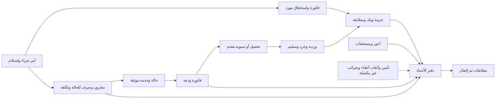

# المراجعة الحالية لنظام حسابات مستشفى رمسيس — S11

**تاريخ استكمال التقرير:** 4 نوفمبر 2026 ، القاهرة.
**النتيجة:** أساس مالي وتشغيلي متقدم ومختبر محليًا، ودورة المستشفى الشاملة ما زالت غير مكتملة. **التشغيل الحقيقي NO-GO.**

## 1. المصدر وحدود الأدلة

قُرئ ملفا التسليم أولًا، وفُكت الحزمة بأمان مع رفض المسارات الخارجة والروابط الرمزية. استُعيد Git من Bundle عند S10 `49167d9` على فرع S11 ، ونجح `git fsck`. جميع 607 بصمات النقل سليمة؛ ملفات السورس 596 مطابقة للمستودع. أرشيف V8.0 المنفصل مطابق للأرشيف داخل التسليم ببصمة SHA256 المذكورة في README.

المراجعة تشمل الخطط الرئيسية G2P/G2T و RAMSES_MASTER_PLAN والقرارات الحالية، و 21 وحدة Python جذرية، وحصر 225 مسارًا معلنًا بديكور routes ، ومخططًا يحوي 113 تعريف جدول و 241 تعريف trigger ، وواجهات JavaScript/CSS/RTL ، واختبارات المصدر. الحصر ساكن؛ ليس شهادة اختبار صلاحيات فردية لكل مسار.

حُصرت 217 نسخة ملف مهارة مثبتة من المكتبات المتاحة، تشمل نسخًا متكررة. لا توجد أداة حية موحدة لقائمة المهارات في الجلسة؛ استُخدم الكتالوج المتاح وفحص الملفات. `skill-inventory.json` يحفظ الاكتشاف. شُغّلت مهارة Project Autopilot للتنسيق، ومعها التشخيص المنهجي و TDD والتحقق قبل التسليم والأمان واختبار الويب و UI/UX ومراجعة الكود. استُخدم مراجع مستقل للأمان وآخر للدورة المالية، ثم مراجعة مستقلة لتغييرات S11. بيانات الاختبار وهمية؛ لا اتصال بحسابات أو قاعدة تشغيل أو خدمات مستشفى.

**الأدلة تفصل بين:** تشغيل سكربت كامل، واختبار واجهة ببيانات ثابتة، وواجهة تتصل بـ ASGI/SQLite حقيقيين عبر جسر اختباري، و TCP/HTTP محلي حقيقي. HTTPS وشبكة المستشفى والطابعات والتوقيعات والاستعادة على جهاز مستقل غير مثبتة.

## 2. الوضع الفعلي حسب مراحل المشروع

| المرحلة | المنفذ فعليًا | ما يمنع اكتمالها |
|---|---|---|
| M0 المصدر والهجرات و CI | Git محفوظ حتى S10 وتغييرات S11 ، CI مصدرية، مخططات تاريخية، rollback مشفر، اختبار V8.0 الأصلي | مستودع خاص وتشغيل PR/CI بعيد غير مرصود؛ سجل migrations مرقم شامل وتغطية مصادر الترقيات الثلاثة الناقصة؛ ترحيل قاعدة تشغيل وأرصدة موقعة |
| M1 الأمان والتعافي | جلسات مجزأة و CSRF وضوابط قراءة وملفات، سجلات تدقيق محمية من تعديل SQL عادي، AES-GCM ونسخ ما قبل الترقية، استعادة وفحوص مالية | حد حجم الطلب قبل parsing ، fail-closed عند فقد ملف DB ، تحقق مصدر المستخدم خلف proxy ، MFA وإدارة مفاتيح واحتفاظ وسجل تدقيق خارجي واستعادة فعلية مستقلة |
| M2 الصلاحيات | أدوار ونطاق نقطة/خزنة/بنك/مخزن، سحب تفويض حي، فصل اعتماد، دور طبي محدود | مصفوفة معتمدة لجميع العمليات والأقسام/التصدير، سياسات بديل غياب المراجع والطوارئ، تحقق ميداني من التوزيع الحقيقي للمستخدمين |
| M3 الكاشير والخزن والبنوك | ورديات بتاريخ سريان، جرد وتسليم واعتماد مستقل، مقدمات/تحصيل/رد، استدراكات ورقية وفروق، POS ومطابقة بنك | سياسات chargeback والتسوية بين الشهور، مستندات فعلية وطابعات وعهد ومراجعة جميع التقارير؛ لا تعامل إلكتروني حقيقي مع البنك مثبت |
| M4 إقامة وتسعير | أسرة وإشغال وتحويل وليالٍ وتعريفات بتاريخ سريان، توثيق الخدمة وفحوص إقفال | تعارض ليلة آخر الشهر مؤكد؛ اعتماد وحدة الاستحقاق والخروج الطبي والباقات؛ المقترح المالي منفصل وغير مفعّل |
| M5 العمليات والحضانات | أنواع حالات وأسرة NICU وخدمات عامة وإثبات طبي وتكلفة مستلزمات مرتبطة | أمر العملية/التخدير والفريق والموارد والتوقيت والباقات والإلغاء، وربحية الحالة الكاملة؛ تكلفة المستلزمات وحدها لا تكفي |
| M6 المشتريات والمخزون والموردون | PO معتمد واستلام جزئي وربط فاتورة، آجال واستحقاقات وطلب دفع وسند بنك، FIFO وصرف/مرتجع وفحص/إعدام، كشف 2200 ونسبة التاريخ لمورد وكشف افتتاحي مستقل | مخازن متعددة وتحويل وجرد فعلي، دورة مرتجع للمورد وإشعار دائن/مدين وضرائب، صيدلية/صلاحيات وأرصدة مخزون موقعة، سياسة فروق 2200 |
| M7 المرتبات والأطباء | أجور شهرية/ساعات وسلف وإضافات وخصومات واستحقاق ومراجعة وربط GL | عقود ونسب واستحقاق ودفتر مساعد للأطباء؛ `doctor_fees` بند مصروف صرف فقط؛ حضور و HR واستقطاعات قانونية ومطابقة رقابية كاملة |
| M8 الأستاذ والإقفال والتأمين | قيد مزدوج بالقروش وقيود مصدرية ومراجعة وعكس، ميزان مبدئي، مطابقة مريض/خزنة/مخزون ومورد، إقفال محكوم | التأمين/المطالبات والرفض وذمم الجهات، ضريبة/فاتورة إلكترونية، الأصول والإهلاك والقوائم النهائية والإقفال السنوي؛ مطابقة كل الدفاتر المساعدة لم تكتمل |
| M9 الاختبارات والواجهة والأداء | سكربتات معزولة واختبارات سلبية وتزامن، يوم مالي موحد، Chrome/RTL/Cairo ، فحوص استعادة | اختبار كل الأدوار على أجهزة وشبكة وطابعات المستشفى، أهداف أداء مقاسة بحجم حقيقي، انقطاع واتصال ونسخ ومراقبة عملية، فحص وصول شامل |
| M10 القبول والإطلاق | أدلة محلية ودلائل تشغيل فقط | تشغيل موازٍ وتدريب وتوقيع حسابات/طبي/IT/إدارة، مصدر بيانات وأرصدة موثوق، خطة دعم وحوادث وتراجع معتمدة |

الخطة القديمة التي تعتبر PO/فواتير المورد/السداد أو الدور الطبي أو تشفير rollback غير منفذة أصبحت تاريخية في هذه البنود. وفي المقابل، وجود صفحات وتقارير لا يغلق دورات الأطباء والتأمين والضرائب والإقفال السنوي. التفاصيل بالأسماء والأسطر في [مراجعة الدورة المالية](S11_FINANCIAL_CYCLE_REVIEW.md).

## 3. ترابط الدورة المالية

اختبار S4 عبر قاعدة واحدة يربط خدمات/فاتورة مريض 100 ج، إجمالي تحصيل ورديات 600 ج، استدراك ظرف 1300 ج، مصروف خزينة 50 ج، خزينة نهائية 1850 ج، رصيد مورد 40 ج وبنك 140 ج، وأستاذ متزن، مع حظر الإقفال عند بقاء سبب صحيح. نجح محليًا عبر 161 طلب TCP/HTTP. لا يثبت ذلك اكتمال الوحدات غير المنفذة أو مصادقة المستندات الفعلية.

## 4. العيوب المثبتة والأولوية

| الرمز | الأولوية | الحالة الحالية | الأثر والدليل |
|---|---|---|---|
| S11-AUDIT | P1 | أُصلح واختُبر | autocommit كان يثبت مستخدمًا/موظفًا/خزنة و GL رغم فشل audit ؛ الآن BEGIN IMMEDIATE ومعاملة واحدة. RED/GREEN و HTTP موجودة. |
| S11-CASE-STOCK | P1 | أُصلح واختُبر وقائيًا | إقفال حالة دون حسم صرف معلق كان يحبس الطلب وإقفال الشهر؛ preflight الآن يمنع الطلب والاعتماد المتأخر، ويظل الرفض المستقل متاحًا. حالات تشغيل قديمة عالقة تحتاج معالجة مستقلة. |
| S11-DAY | P1 | أُصلح واختُبر | اليومية كانت تعطي تحذيرًا عامًا وتغيب عنها تفاصيل ورديات لم تُفتح؛ الآن استثناءات مسماة وإجراء متابعة، مع احترام نطاق القراءة وعدم ادعاء اعتماد مالي. |
| S11-QA | P1 للتحقق | أُصلح |12 اختبار واجهة فشلوا لافتراض Linux ؛ توحيد اختيار المتصفح في 48 سكربت، دون تبديل assertions أو تغطية الفشل بالتجاوز. |
| S11-DEPS | P1 صيانة أمنية | تحديث وفحص وتوافق | قيد cryptography<47 منع الإصدارات الأمنية الأحدث، و pip القديم له تحذيرات؛ تحديث 50.0.2/26.3 والتحقق من استعادة نسخ 46.0.7. لا دليل على استغلال سابق في المستشفى. |
| FIN-01 | P1/مانع M4 | مفتوح، مقترح جاهز للاعتماد | آخر ليلة شهر لا تُفوتر عاديًا بعد اكتمالها في الشهر التالي ويظل الإقفال محظورًا. طلب صاحب المشروع مقترحًا لرئيس الحسابات، لا قيدًا جديدًا آليًا. |
| SEC-01 | P1/مانع أمني | مفتوح | رفع 8MiB دون جلسة يُرفض 401 بعد spooling كامل؛ حد الملف داخل handler متأخر. المطلوب حد ASGI/edge على كامل stream قبل parsing واختبارات 413 ومشروعية الرفع. |
| SEC-03 | P2 | مفتوح | فقد ملف DB ثم GET يمكنه إنشاء SQLite فارغة؛ فصل bootstrap عن runtime مع mode=rw ورسالة 503 واختبار عدم الإنشاء. |
| SEC-04 | P2 ، تابع للنشر | مفتوح | خلف proxy قد يتشارك العملاء مصدر socket وبالتالي حظر الدخول؛ يجب اختبار سلسلة الثقة على التركيب الفعلي دون الثقة العمياء بـ headers. |
| UX-OPS | P1 للقبول | مفتوح | كثرة المسارات، الطباعة والبحث والقوائم الطويلة والتحميل والاستثناءات تحتاج UAT لكل وظيفة؛ نجاح اختبارات شاشات محددة لا يعني تدقيق وصول شامل. |

تفاصيل الأمان وإعادة الإنتاج والمواقع الأصلية في [المراجعة الأمنية](S11_SECURITY_REVIEW.md). أُغلقت نقطة SEC-02 فيها بإصلاح S11-AUDIT ؛ التقرير يحتفظ بوضعها عند اكتشافها لأثر المراجعة. لم تثبت المراجعة اختراقًا أو تسربًا إنتاجيًا.

## 5. الواجهة العربية وقابلية الاستخدام

واجهة اليومية المعدلة تعرض اسم النقطة والوردية والحالة والمتابعة المطلوبة، وتفرّق بين «لم تسجل إلكترونيًا» و«لم يحن موعدها» و«غير مرصودة». لا يفترض غياب التسجيل غياب حركة نقدية. يحافظ العرض على `esc` لكل نص متغير، ويستند إلى صلاحيات الخادم.

اختبار Chrome على 375 و1440 بكسل وصل إلى خادم ASGI وقاعدة SQLite حقيقيين عبر جسر اختباري، وفحص `dir=rtl`، وتحميل Cairo من ملفات المشروع فعليًا، وعدم التمدد الأفقي في الصفحة والحوار، وعدم أخطاء JavaScript. اختبار تغطية الورديات السابق نجح أيضًا. الصور في `evidence/S11/daily-exceptions-*.png`.

لم يُنفذ تدقيق WCAG شامل أو تجربة طابعة حقيقية. الاختبار البصري لا يثبت أن جميع المسارات ورحلات المستخدم سهلة الاستخدام أو مخولة صحيحًا؛ قبول كل وظيفة على معدات المستشفى جزء من المرحلة التالية.

## 6. الاختبارات والتطوير الفعلي

يراجَع [تقرير الاختبارات الحالي](TEST_REPORT.md) للأعداد النهائية وأوامر الإعادة. النتائج السابقة داخل S10 محفوظة باعتبارها سجلًا تاريخيًا. أضيفت ثلاثة اختبارات للخادم قبل الإصلاح، واختبار واجهة، ومشغل HTTP لكل إصلاح، مع أدلة RED/GREEN.

أول تشغيل S10 في هذه البيئة: 147 سكربتًا = 128 PASS و5 SKIP و14 FAIL؛ اثنا عشر اختبارًا يفترضان مسار Chromium خاصًا بـLinux، واختبارا TCP ممنوعان داخل sandbox. نجحت الإعادة بعد تصحيح مسار المتصفح والسماح بالاتصال المحلي. لم يُعد تصنيف الفشل تلقائيًا كنجاح. اختبار V8.0 نجح من الأصل المقدم.

التجاوزات الخمسة: اختباران يتطلبان ملف Excel يونيو الخاص غير الموجود، وثلاث ترقيات تحتاج مصادر G2I/G2J/G2K السابقة التي لا يوفرها Bundle التسليم. تتوفر مخططات هجرات أخرى ومصادر أقدم، لكنها لا تستبدل هذه المدخلات.

## 7. ترتيب الاستكمال بعد هذه المرحلة

1. معالجة SEC-01 بحد حجم الطلب قبل تحليل محتواه، ثم منع إنشاء قاعدة فارغة أثناء التشغيل والتحقق من مصدر المستخدم خلف proxy؛ استكمال إدارة الجلسات عند التعافي.
2. اعتماد [مقترح ليلة نهاية الشهر](MONTH_END_STAY_POLICY_PROPOSAL_AR.md)، ثم إنجاز التواريخ والاستحقاق ومطابقته والفوترة والإقفال باختبارات قبل وبعد.
3. اعتماد سياسة 2200 وأرصدة الموردين والمخزون، وإكمال المرتجع للمورد والجرد والمخازن المتعددة وفق نطاق المستشفى.
4. نمذجة مستحقات الأطباء والتأمين من العقود المعتمدة، ثم إكمال المطابقات والضرائب والأصول والإقفالات. يُنفذ كل جزء بمستند ومراجعة وقيد ودفتر مساعد وتسوية.
5. تجهيز بيئة قبول معزولة بالمستشفى، واستعادة مشهودة على جهاز آخر، وبيانات افتتاح موقعة، وصلاحيات واقعية وطباعة وشبكة HTTPS وتدريب وتشغيل موازٍ، ثم قرار إطلاق موقع.

## 8. التسليم والقيود المتبقية

يحفظ الإصدار السورس وسجل Git والتقارير الفعلية ومقترح السياسة وقرارات المراجعة. لا يمكن إعلان موعد إطلاق أو نسبة إنجاز قبل تحديد العقود والحجم والاعتمادات والفريق وبيئة المستشفى. **الترحيل التاريخي للمخطط نجح؛ ترحيل بيانات تشغيل مستشفى وأرصدة بداية معتمدة لم يحدث.**

قرار الاستمرار في التطوير إيجابي، وقرار التشغيل الحقيقي يظل موقوفًا على العيوب والبوابات أعلاه.
